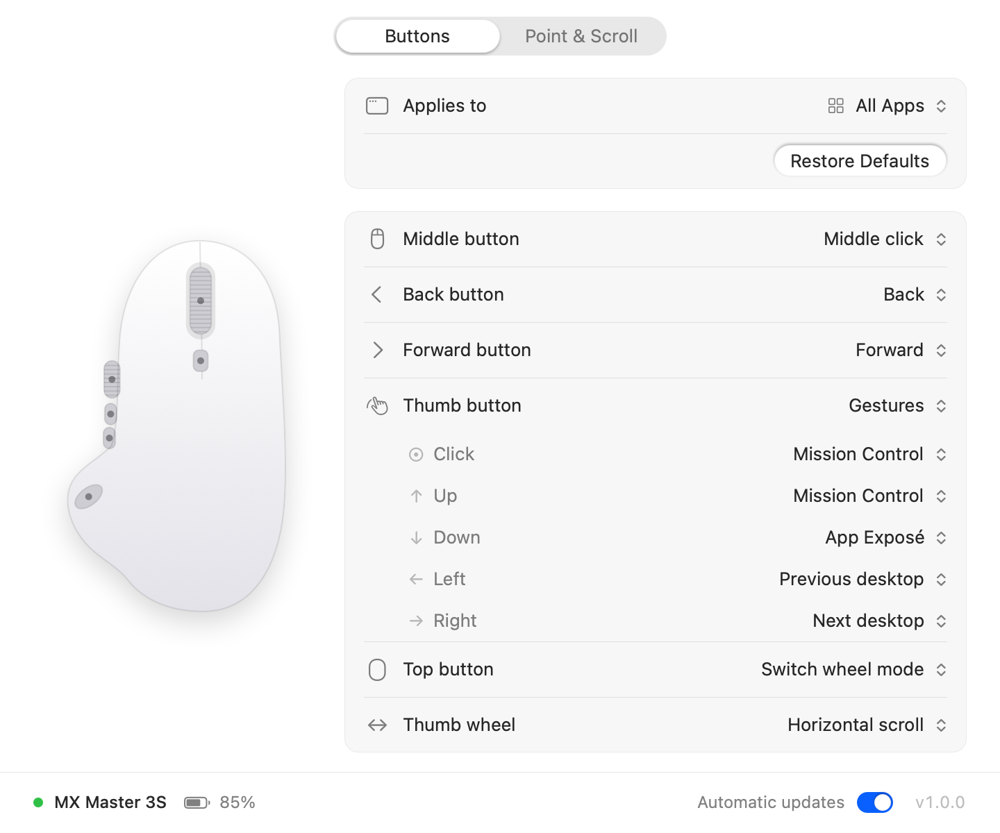
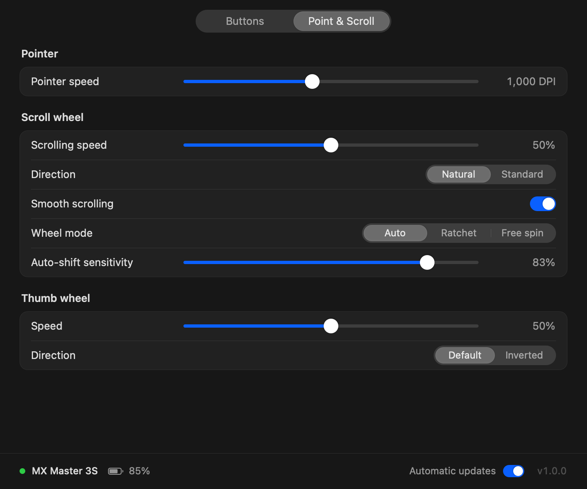

# Mouse

**A tiny, fast settings app for the Logitech MX Master 3S on macOS.** Customise the buttons,
thumb-button gestures, pointer speed and scrolling without Logi Options+.



|                         | Mouse            | Logi Options+     |
| ----------------------- | ---------------- | ----------------- |
| Memory in the background | **2–3 MB**       | about 180 MB      |
| Download                | about 0.2 MB     | hundreds of MB    |
| Account, telemetry, ads | none             | yes               |

Memory is the background agent's footprint (the number Activity Monitor shows), measured with
`footprint` on macOS 27 with the mouse connected: 2.1 MB at rest, up to about 2.8 MB once it has
been sending clicks, keys and scrolling. Layouts for specific apps add about 0.5 MB, for asking
macOS which app is in front. The settings window takes about 24 MB while it is open and nothing
once closed.

- **Buttons**: middle, back, forward, thumb and top buttons, plus the thumb wheel. Pick from a
  short list of useful actions (Mission Control, App Exposé, Dictation, ⌘-click, switch apps,
  play/pause and more) or record any keyboard shortcut. Buttons work like keys: tap **Switch to
  last app** to go back to the previous app, or hold it to keep the app switcher open, point at
  an app and let go. A shortcut can also be a single key like right ⌘ or left ⌥, held for as
  long as the button (the trigger many dictation apps use).
- **Per app**: give any app buttons, gestures and a thumb wheel of its own; every other app uses
  the layout for all apps. A new app can start with the buttons of one you have set up already,
  and **Copy From** copies them at any time (say Brave with Chrome's). **Remove** returns an app
  to the layout for all apps, and **Restore Defaults** puts a layout back.
- **Gestures**: hold the thumb button and move the mouse up, down, left or right.
- **Point & Scroll**: pointer speed (200–8000 DPI), scrolling speed and direction, smooth
  scrolling, wheel mode (auto-shift, ratchet or free spin) and thumb-wheel speed and direction.
- **Instant**: no animations and no delays. Changes reach the mouse the moment you make them.
- **Automatic updates**: checks this repository's releases a few times a day and installs new
  versions by itself. You can turn it off.



## Install

1. Download **Mouse.zip** from the [latest release](../../releases/latest), unzip it and move
   **Mouse.app** to **Applications**.
2. Open Mouse. Mouse is free and not notarised by Apple, so the first time macOS may refuse to
   open it. Go to **System Settings → Privacy & Security** and click **Open Anyway**. You can
   also run this once in Terminal:
   ```sh
   xattr -dr com.apple.quarantine /Applications/Mouse.app
   ```
3. Click **Allow…** in the window and turn on **MouseAgent** in **Privacy & Security →
   Accessibility** and **Input Monitoring**. The agent is the small background part of Mouse:
   it needs these to talk to your mouse and to perform button actions.

MouseAgent starts at login. Open Mouse whenever you want to change something: closing the
window quits it, while MouseAgent keeps running in the background.

If Logi Options+ is installed, quit it first so the two don't fight over the mouse.

### Requirements

- A Mac with Apple silicon and macOS 27 or later
- MX Master 3S connected over **Bluetooth** (the Logi Bolt receiver is not supported yet)

## Build from source

```sh
make test      # unit and simulator tests (AddressSanitizer + UBSan)
make app       # build/Mouse.app
make install   # copy to /Applications and open it
make simulate  # build/mouse-simulate: a scripted, simulated mouse with real output (development)
```

The code is C++20 with a thin AppKit layer and no third-party dependencies:

- `src/core`: settings, the HID++ 2.0 protocol, device logic, gestures and scrolling (portable, tested)
- `src/sim`: a simulated MX Master 3S used by the tests
- `src/mac`: MouseAgent (the background agent: IOKit HID access, event output, updater)
- `src/ui`: the settings window (Mouse.app; quits when closed)

Useful commands:

```sh
# Read the connected mouse (name, battery, DPI range, features) without changing anything
/Applications/Mouse.app/Contents/Helpers/MouseAgent.app/Contents/MacOS/MouseAgent --info
# Show what the mouse reports for 15 seconds (buttons, wheels, battery)
/Applications/Mouse.app/Contents/Helpers/MouseAgent.app/Contents/MacOS/MouseAgent --probe
# Render the settings window to PNG files
make snapshot
```

## Uninstall

```sh
launchctl bootout gui/$(id -u)/app.mouse.agent
rm -f ~/Library/LaunchAgents/app.mouse.agent.plist
rm -rf /Applications/Mouse.app ~/Library/Application\ Support/Mouse
```

## Privacy

Mouse has no account, analytics or tracking. The only network request is the update check,
which asks GitHub for this repository's latest release. Turn off **Automatic updates** to
stop it. With layouts for specific apps, MouseAgent asks macOS which app is in front when you
press a button; it keeps no record of it.

## License

MIT. See [LICENSE](LICENSE).

Mouse is an independent project. It is not affiliated with or endorsed by Logitech.
Logitech, MX Master and Logi Options+ are trademarks of Logitech.
